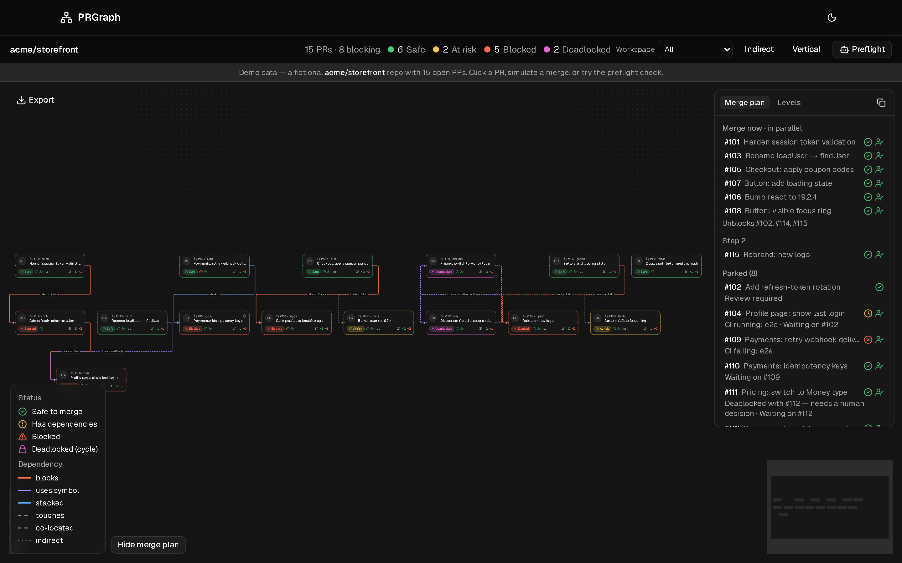
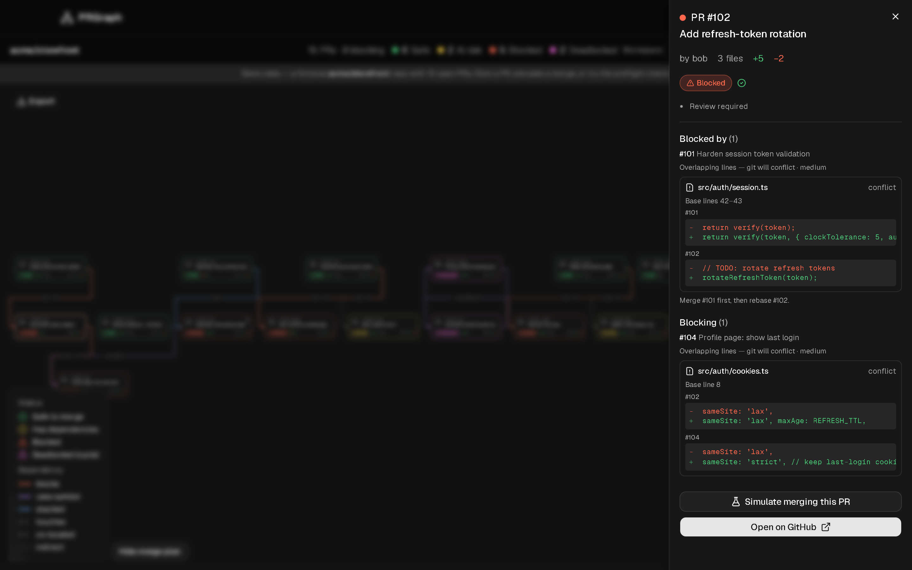
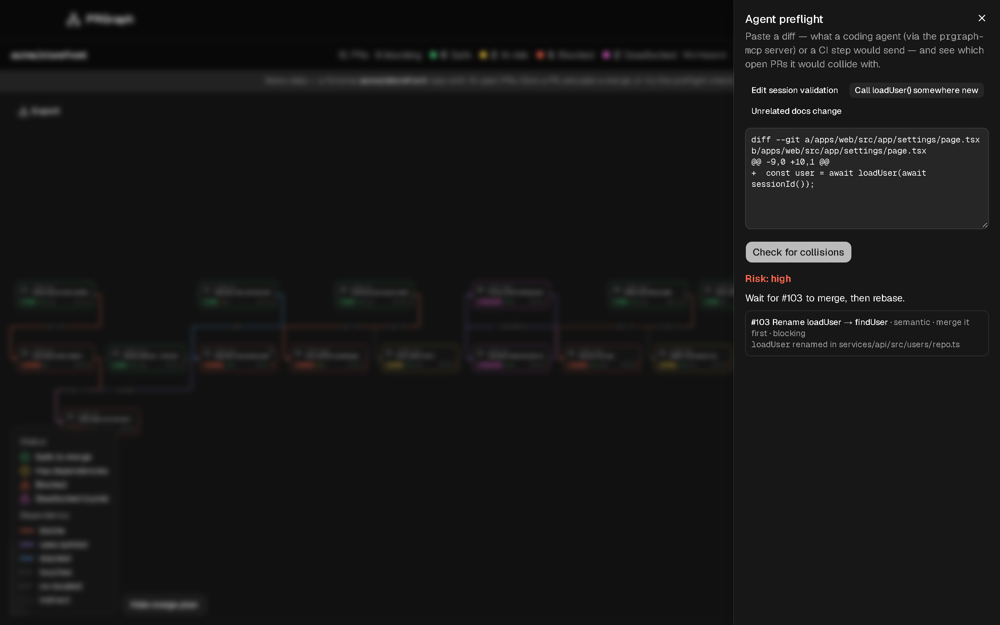
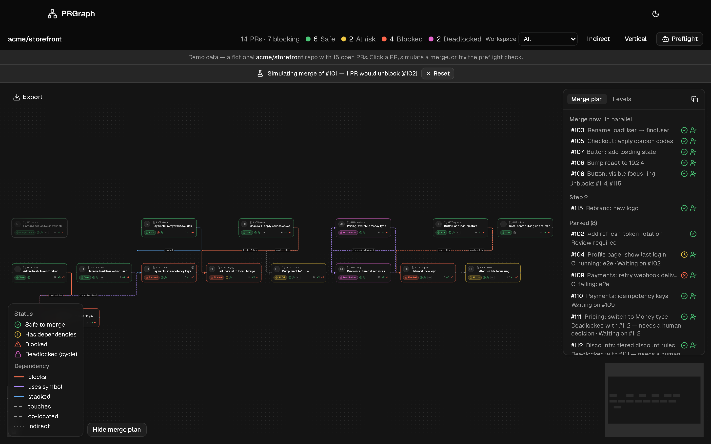
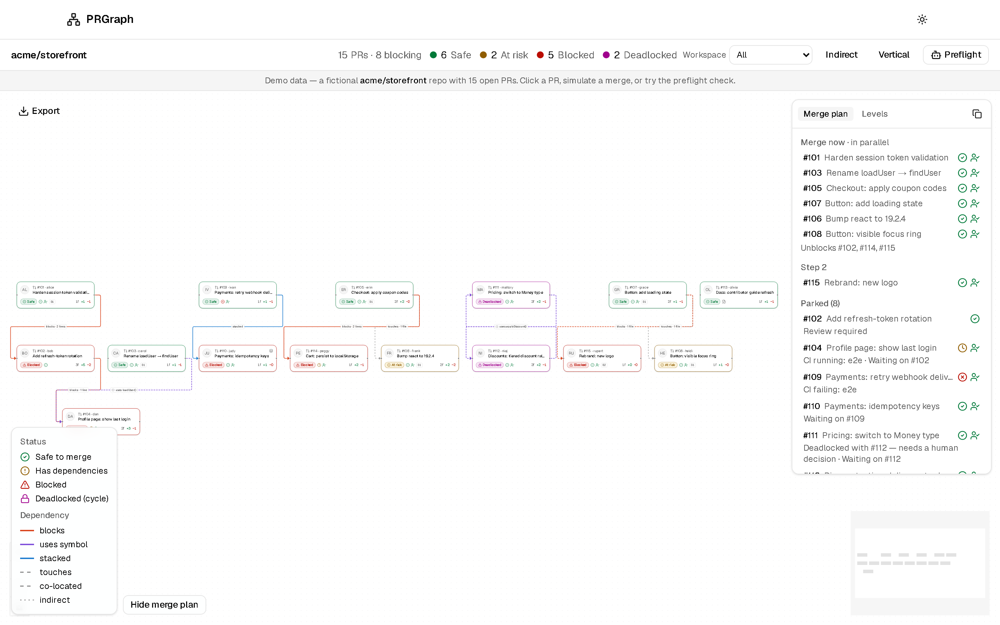
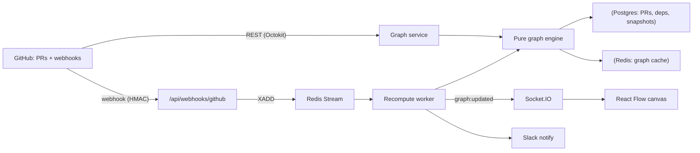

# PRGraph

**Know which pull requests will collide — before anyone merges.**

PRGraph turns a repository's open pull requests into a live, interactive **dependency graph**. It
compares every pair of open PRs **line by line**, catches **cross-file breakage** (one PR renames a
function another PR calls), understands **stacked PRs**, and combines all of that with CI, reviews
and branch rules into a **merge plan**. GitHub webhooks keep it live over WebSockets, Slack hears
when a merge unblocks others, an opt-in **Check Run** reports conflicts on every PR, and AI coding
agents can ask *"will my change collide?"* through an **MCP server** before a PR even exists.



> **Try it without GitHub:** `npm run dev`, then open <http://localhost:3000/demo> — a fictional
> 15-PR repository run through the real engine.

## Why PRGraph (vs. merge queues and AI reviewers)

Merge queues (Graphite, Mergify, Aviator, Trunk, GitHub's merge queue) discover conflicts only once
a PR is *in* the queue, by rebasing it and burning CI. AI reviewers look at one PR at a time. GitHub
reports only PR-vs-base conflicts. PRGraph looks at **all open PRs together**:

| Differentiator | What you get |
|---|---|
| **Predictive merge simulation** | Exact conflicting **base lines** between open PRs from their patches (zero extra API calls), upgraded by a **diff3 sequential merge** when branches have drifted. Property-tested to agree with diff3. |
| **Cross-file symbol impact** | PR A renames / re-signatures `getUser()`, PR B adds a call to it in another file → a `SEMANTIC` edge. Git merges cleanly; the build would break. |
| **Conflict-aware merge plan** | Parallel merge batches from the conflict graph **plus** CI status, reviews, mergeability and branch rules; parked PRs with reasons; the critical path; *what-if* merge simulation. |
| **Agent preflight + MCP + Check Run** | `POST /api/v1/preflight` and the `prgraph-mcp` server answer "will this change collide?" for AI agents and CI; an opt-in `PRGraph` Check Run (optionally a required check). |

| Status | Meaning |
|---|---|
| 🟢 **Safe to merge** | no other open PR affects it |
| 🟡 **Has dependencies** | shares files with other PRs but merges cleanly |
| 🔴 **Blocked** | another PR must land first (overlapping lines, a symbol it uses, or its base branch) |
| 🟣 **Deadlocked** | PRs depend on each other — a human picks the order |

<table>
<tr><td></td>
<td></td></tr>
<tr><td align="center"><sub>Line-level evidence from both PRs</sub></td><td align="center"><sub>Agent preflight playground</sub></td></tr>
<tr><td></td>
<td></td></tr>
<tr><td align="center"><sub>What-if merge simulation</sub></td><td align="center"><sub>Light theme</sub></td></tr>
</table>

## How it works



The **graph engine** (`src/lib/graph`) is pure and deterministic — no I/O, no clocks, no randomness —
so it is trivially testable and cacheable. Everything else (GitHub, Redis, Postgres, Slack, sockets)
is infrastructure around that core.

## Tech stack

- **Next.js 16** (App Router) + **React 19.2** on **Node.js 24**, TypeScript strict
- **Custom server** (`server/websocket.ts`) hosting the Next handler **and** Socket.IO in one process
- **PostgreSQL 16** via **Prisma 7** (driver adapter) · **Redis 7** (cache, dedupe, Streams queue, pub/sub)
- **React Flow** (`@xyflow/react`) + **dagre** layout · **Tailwind v4** + **shadcn/ui**
- **Octokit** (GitHub App + OAuth) · **Slack** (`@slack/web-api`) · **Prometheus** metrics

## Quickstart (local)

Prerequisites: Node 24, npm, Docker (for Postgres + Redis).

```bash
# 1. Install deps
npm install

# 2. Configure env
cp .env.example .env        # fill in GitHub App / OAuth secrets; generate SESSION_SECRET + ENCRYPTION_KEY

# 3. Start infrastructure
docker compose up -d postgres redis

# 4. Apply the schema
npm run db:generate
npm run db:migrate

# 5. Run the custom server (Next + Socket.IO + webhook worker)
npm run dev
# → http://localhost:3000
```

Generate secrets:

```bash
# SESSION_SECRET (any long random string)
openssl rand -hex 32
# ENCRYPTION_KEY (base64-encoded 32 bytes — used to encrypt stored tokens)
openssl rand -base64 32
```

### GitHub App

Create a GitHub App (Settings → Developer settings → GitHub Apps) with:

- **Permissions:** Pull requests (read), Contents (read), Metadata (read), Checks (read & write —
  CI overlay + the opt-in `PRGraph` Check Run), Commit statuses (read), Actions (read)
- **Webhook URL:** `https://<your-host>/api/webhooks/github`, secret = `GITHUB_WEBHOOK_SECRET`
- **Subscribe to events:** Pull request, Pull request review, Check suite, Check run, Status
- **Callback URL** (OAuth): `https://<your-host>/api/auth/callback`

## Scripts

| Script | Description |
|---|---|
| `npm run dev` | Custom server (Next + Socket.IO + worker) via tsx watch |
| `npm run build` | `next build` (Turbopack) |
| `npm run build:server` | Bundle `server/websocket.ts` → `dist/server.mjs` (esbuild) |
| `npm start` | Run the compiled custom server (`node dist/server.mjs`) |
| `npm test` | Vitest unit + property tests (engine, planning, preflight, bot, tokens) |
| `npm run test:integration` | Vitest against real Postgres + Redis (coalescing, tokens, Check Run idempotency) |
| `npm run e2e` | Playwright E2E (Chromium) against the built server — demo graph, preflight, a11y (axe), auth |
| `npm run screenshots` | Regenerate `docs/images/*.png` |
| `npm run lint` / `typecheck` | ESLint / `tsc --noEmit` |
| `npm run db:migrate` / `db:deploy` | Prisma migrate (dev / prod) |
| `npm run eval` | AI semantic-conflict eval harness — grades the shipping analyzer |
| `npm run eval:baseline` | Write `evals/baseline.json` from the current run |
| `npm run eval:ci` | Eval in CI mode (fail on F1 below threshold or >5pt regression) |
| `npm run eval:impact` / `eval:impact:ci` | Cross-file symbol-impact eval: synthetic + 111 real commit pairs from 8 OSS repos (see `evals/README.md`) |

## Docker

```bash
# build + run the full stack (app + postgres + redis)
SESSION_SECRET=... ENCRYPTION_KEY=... docker compose up --build

# with Prometheus
docker compose --profile monitoring up --build
```

The image deliberately does **not** use Next's `output: 'standalone'` — that would drop the Socket.IO
server. Instead it ships `.next` + the esbuild-bundled custom server + a production `node_modules`, and
runs `prisma migrate deploy` before booting (`scripts/start.sh`).

## Project structure

```
server/websocket.ts        Custom Node server: Next + Socket.IO + worker
src/lib/graph/             Pure deterministic engine: patch regions, diff3 merge simulation, symbol
                           impact, stacks, Kahn/DFS, merge plan, what-if, preflight, workspaces + service
src/lib/github/            Octokit client, PR/file fetchers, webhook HMAC verify
src/lib/events/            Redis Streams producer + consumer-group worker (DLQ)
src/lib/cache/             Redis singletons + cache-aside helpers
src/lib/slack/             Block Kit builder + notifier
src/lib/ai/                AI semantic-conflict layer (adapters: openai, anthropic, ollama)
src/lib/bot/               PRGraph Check Run publisher (content-hashed, idempotent)
src/lib/demo/              Demo fixture repo (public /demo, E2E, screenshots)
packages/prgraph-mcp/      MCP server + CLI for AI agents and CI (standalone package)
e2e/                       Playwright specs
src/lib/resilience/        Timeout / retry / circuit breaker
src/components/graph/      React Flow canvas, PR node, legend, detail panel
src/app/                   App Router pages + API route handlers
prisma/schema.prisma       Database schema
.claude/skills/            Engineering rules (wired via AGENTS.md)
SCALING.md                 Architecture for millions of users
docs/AI_ARCHITECTURE.md    AI layer design + measured eval numbers
```

## AI (Phase 2 — live behind a flag)

Design, rules and measured eval numbers: [`docs/AI_ARCHITECTURE.md`](docs/AI_ARCHITECTURE.md).

`src/lib/ai` is a provider-agnostic LLM adapter (`adapters/`: openai, anthropic, ollama), a versioned prompt registry, a
Zod-validated verdict schema, a content-addressed cache, a daily-budget breaker, and a **heuristic
fallback**. It is wired into the live graph recompute but **off by default** (`AI_ENABLED=false`).

When enabled, after the deterministic engine builds the graph, each edge with shared files or
symbol links is sent to `analyzeOrFallback` (cache → adapter → Zod → heuristic) with bounded
concurrency, using diffs derived from the PR patches **already fetched** plus the engine's findings
as FOCUS notes (prompt `conflict.v4`). Any LLM error/timeout, or hitting the daily budget, degrades
that edge to the deterministic verdict.

How verdicts map to the graph (`refineGraph`, pure):

- **Exact textual conflicts are facts** (overlapping base lines, diff3 conflict, stacked branches):
  the verdict is attached as an explanation + suggested resolution, never demoted.
- **Approximate evidence** (no patch, base drift, regex-based symbol links): `CO_LOCATED` demotes the
  edge to non-blocking, so PRs can unblock or a deadlock can break.
- **Clean merges** (`TOUCHES`): a `TRUE_CONFLICT` verdict is shown as a logical-risk note and the PR
  stays *Has dependencies* — the AI never adds a blocking edge.
- `UNCERTAIN` — treated conservatively (no change).

### Enabling it

1. Set `OPENAI_API_KEY` (and optionally `LLM_PROVIDER`, `LLM_DAILY_BUDGET_USD`).
2. Validate accuracy on the labeled set:
   ```bash
   AI_ENABLED=true OPENAI_API_KEY=sk-... npm run eval     # expect F1 >= 0.80
   npm run eval:baseline                                  # record the baseline
   ```
3. Flip `AI_ENABLED=true`. CI's secret-gated `eval-ai` job re-checks F1 >= 0.80 (and no >5pt
   regression vs `evals/baseline.json`) on every push; the offline `eval` job always guards the
   heuristic at F1 >= 0.60. Telemetry (`prgraph_llm_*`, `prgraph_ai_*`) feeds the Grafana AI row.

## Agent preflight & MCP server

Give coding agents (Claude Code, Cursor, Copilot agents…) a way to check for collisions **before**
they open a PR. Create a token in **Repo settings → API tokens** (scopes `preflight:read`,
`graph:read`), then add the MCP server:

```json
{
  "mcpServers": {
    "prgraph": {
      "command": "npx",
      "args": ["-y", "prgraph-mcp"],
      "env": { "PRGRAPH_URL": "https://<your-host>", "PRGRAPH_TOKEN": "prg_…", "PRGRAPH_REPO": "owner/name" }
    }
  }
}
```

Tools: `preflight_check` (diffs the current branch against `origin/main` when no patch is given),
`get_merge_plan`, `get_pr_conflicts`, `list_blocked_prs`. The same binary works as a CI step:

```bash
git diff origin/main...HEAD | npx prgraph-mcp preflight --repo owner/name --fail-on high
```

Raw API: `POST /api/v1/preflight` with `Authorization: Bearer prg_…` and
`{ "repo": "owner/name", "patch": "<unified diff>" }` → `{ risk, collisions[], waitFor[], recommendation }`.
Tokens are stored only as SHA-256 hashes and rate-limited to 60 requests/minute.

## Scaling and security

- [`SCALING.md`](SCALING.md) — process roles, partitioned ingestion, incremental compute over
  SHA-keyed facts, GitHub API budgets, storage, realtime fan-out and AI cost at millions of users.
- Dependencies: production dependencies audit clean (`npm audit --omit=dev`, enforced in CI). One
  dev-only advisory remains: `braces` (GHSA-vfj7-8cjw-p6xm) via `eslint-config-next` → `fast-glob`
  → `micromatch`. Every published `braces` version is in range and no patched release exists yet;
  it only runs at lint time on our own globs. npm's suggested "fix" is downgrading to the EOL
  Next 14 ESLint config, which we don't take.

## License

[MIT](LICENSE)
